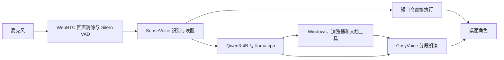

# 银月 · YinYue

银月是一个本地优先的 Windows 语音助手，配有可互动的桌面角色。喊一声「银月」就能开始对话，也可以让它打开应用、查找文件、朗读 PDF，或者在屏幕上跑一圈。

这个个人项目探索的是如何把本地大模型接到真实的桌面操作上，同时让语音交互和 3D 角色能及时反馈正在发生什么。

## 可以做什么

| 场景 | 示例 |
| --- | --- |
| 语音与桌面角色 | 「银月现身」「在屏幕上跑一圈」「跳一段舞」「银月退下」。支持语音打断、桌边退场和音乐卡点。 |
| Windows 操作 | 「打开网易云音乐」「查看电脑配置」「找一下桌面上的 PPT」。优先用文件系统和应用接口处理能直接查到的信息。 |
| 浏览器与文档 | 「打开 B 站搜索马斯克」「播放搜索结果里第 3 个视频」「朗读 PDF 第 1 页英文」。PDF 朗读从文件的文字层提取原文，扫描页需要另行做 OCR。 |
| 个性化 | 在本机积累对话中反复出现的偏好，在相关场景下主动提出建议。 |

## 技术实现



- 语音会话支持朗读打断和播放后的连续接话。短跑圈口令有普通话复核，常见错听可以直接触发同一动作。
- 本地模型按需启动。上下文超限时减少较早的完整对话并自动重试，保留当前请求和工具调用。
- 角色渲染支持程序化 3D 和 VRM。形象、音乐节拍相关的动作与电脑工具调用通过独立模块处理。

## 源码导览

| 模块 | 职责 |
| --- | --- |
| [assistant.py](assistant.py) / [audio_io.py](audio_io.py) | 唤醒、识别、会话、回声抑制、播放和打断 |
| [tools.py](tools.py) / [bili_browser.py](bili_browser.py) | Windows 操作、浏览器搜索、PDF 读取与本地记忆 |
| [avatar.py](avatar.py) / [avatar3d.py](avatar3d.py) / [vrm_avatar.py](vrm_avatar.py) | 桌面窗口、动画与渲染 |
| [cosyvoice/server.py](cosyvoice/server.py) / [remote.py](remote.py) | 本机语音合成与可选的手机遥控 |

## 克隆后立即验证

需要 Windows、Git 和 uv。把项目放在英文路径下。

```powershell
git clone https://github.com/wuqiwuxin5757/yinyue.git
cd yinyue
uv venv --python 3.12
uv pip install --python .\.venv\Scripts\python.exe -r requirements.txt
.\.venv\Scripts\python.exe -m unittest discover -s tests
.\.venv\Scripts\python.exe avatar.py --preview avatar-preview.png
.\.venv\Scripts\python.exe assistant.py --wake-test "银月，跑一圈"
```

这几步无需模型权重。想看桌面角色的实时效果，可以执行 `.\.venv\Scripts\python.exe avatar.py`。如已安装 Node.js，可用 `node --test tests/test_remote_page.cjs` 运行手机遥控页面的单元测试。

## 启用完整语音助手

按 [Windows 部署指南](docs/setup-windows.md) 安装 FFmpeg、配置 llama.cpp 并下载语音和对话模型。发布配置使用程序化 3D 角色，手机遥控默认关闭。联网搜索和在线视频需要网络连接。
