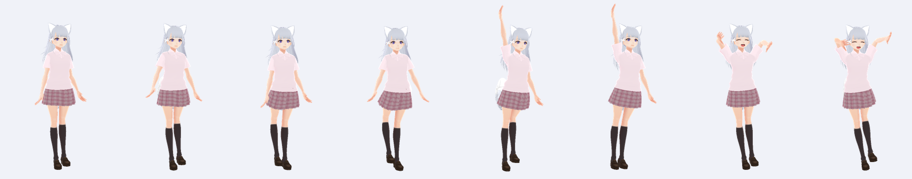
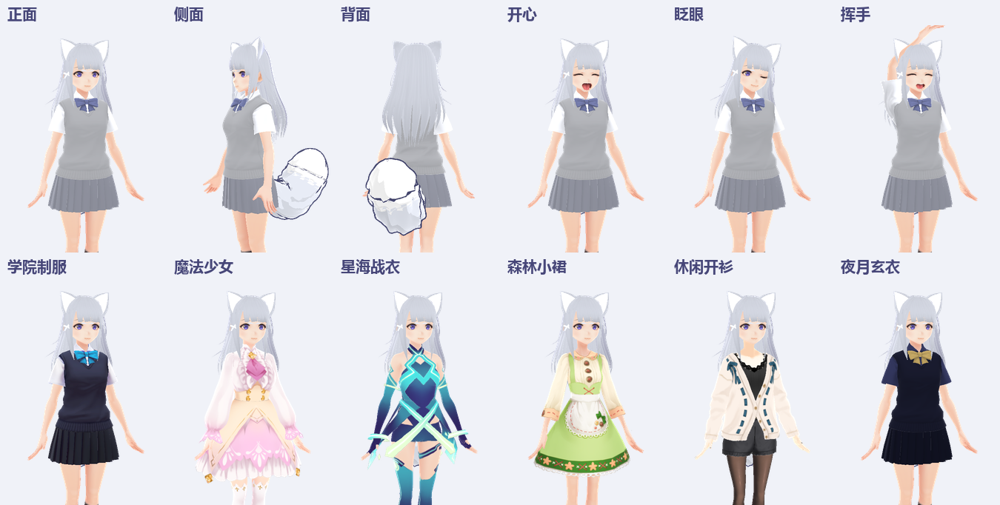
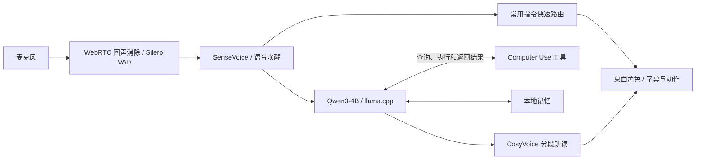

# 银月 · YinYue

**受《钢铁侠》中贾维斯启发的个人 AI 助理，面向 Windows，核心模型在本机运行。**

你可以用自然语言交代任务，让银月在桌面和浏览器里执行操作，或者跟它讨论问题、查阅资料。它会用语音、字幕和 3D 角色反馈当前状态，也能记住你的偏好，在合适的时候主动提议。



## Computer Use · 电脑操作

银月根据任务选择系统接口、文件系统、浏览器内容或屏幕视觉。能直接读取的内容优先走对应接口，依赖画面或界面布局时再识别屏幕。

### Windows 操作

- **应用与窗口** · 打开或关闭应用，将窗口切到前台，输入文字、执行快捷键和滚动。需要根据画面定位控件时，可以查看屏幕并点击指定目标。
- **文件与文档** · 按文件名或扩展名查找、打开本地文件。可以按类型整理文件夹并撤销上一次整理。PDF 支持按页从文字层提取原文、继续读下一页或只读英文。扫描页需要另行做 OCR。
- **系统与媒体** · 查询 CPU、GPU、内存和磁盘等信息，调整音量，控制网易云音乐等播放器。专用工具覆盖不到的本机任务可以调用 PowerShell。也有锁屏和电源管理工具。

### 网页操作

- **浏览与搜索** · 打开网址，在指定站点搜索，并在可用时直接读取搜索摘要或网页正文，用于事实核实、天气查询和资料整理。
- **连续操作** · 在 B 站搜索后，可以接着按结果顺序打开视频。银月会引用上一次的搜索结果，用户可以在同一个会话里继续下达指令。

## 语音交互与音色克隆

- **唤醒、连续对话与插话** · 叫名字唤醒，回答后可以继续接话。朗读中支持语音打断，也可以用托盘或 `Ctrl+Alt+F9` 停止。麦克风输入使用语音活动检测、回声消除和播放期间的回声过滤。
- **分段朗读** · 模型生成回复后分段合成，显示文字随朗读推进。发布版默认使用 CosyVoice 内置中文女声，独立英文片段可以使用英文女声。
- **本地音色克隆** · 可以从有权使用的录音或视频截取一段清晰的单人语音，配上对应文字稿，再用 Fun-CosyVoice 3 在本机复用参考音色、实时合成新句子。`set_voice.py` 负责截取、转单声道与响度规整。克隆需要单独配置，参考音频保存在本机。 [音色配置](#配置参考音色)

## 3D 桌面角色与动效

- **状态反馈** · 桌面角色有待机动作、表情、说话口型和对话气泡。可以通过语音让银月现身或退下，也可以拖到屏幕边缘，让它跨出屏幕、短暂探身再收回。
- **编舞与音乐同步** · 舞蹈由多组动作编排，包含脚步、屈膝、重心变化、转身和前后走位。放入本地音乐后，可分析节拍并让动作跟拍。
- **换装与角色互动** · 用语音指定颜色或款式，也可以从右键衣柜选择、顺序切换或随机换装。换装有过渡动画，退场也有挥手、鞠躬、月光和化狼等不同表现。



## 记忆与多端交互

- **长期记忆** · 可以明确要求银月记住、查看或忘掉某条偏好。它也会从反复出现、实际执行过的互动中积累偏好，在适合的情境里主动询问，例如根据观看习惯建议搜索主题。
- **手机遥控** · 可选开启带访问口令的手机网页，查看桌面角色画面，发送文字或语音，控制动作和换装。公开版默认关闭。

## 技术架构



| 模块 | 职责 |
| --- | --- |
| [assistant.py](assistant.py) · [audio_io.py](audio_io.py) | 唤醒、连续对话、模型调用、回声抑制、朗读打断 |
| [tools.py](tools.py) · [bili_browser.py](bili_browser.py) · [vision.py](vision.py) | 系统与文件操作、网页搜索与读取、可选屏幕视觉、本地记忆 |
| [avatar.py](avatar.py) · [avatar3d.py](avatar3d.py) · [vrm_avatar.py](vrm_avatar.py) | 桌面窗口、程序化 3D 与 VRM 渲染、角色状态和动效 |
| [dance_choreo.py](dance_choreo.py) · [music_sync.py](music_sync.py) | 舞蹈动作编排与本地音乐节拍分析 |
| [cosyvoice/server.py](cosyvoice/server.py) · [set_voice.py](set_voice.py) · [remote.py](remote.py) | 本机语音合成、参考音色制备和手机遥控 |

## 下载与运行

需要 Windows、Git 和 uv。将仓库放在英文路径下。

```powershell
git clone https://github.com/wuqiwuxin5757/yinyue.git
cd yinyue
uv venv --python 3.12
uv pip install --python .\.venv\Scripts\python.exe -r requirements.txt
.\.venv\Scripts\python.exe -m unittest discover -s tests
.\.venv\Scripts\python.exe avatar.py --preview avatar-preview.png
.\.venv\Scripts\python.exe assistant.py --wake-test "银月，打开计算器"
```

上面的测试和预览无需模型权重。可以运行 `.\.venv\Scripts\python.exe avatar.py` 查看实时桌面角色。如已安装 Node.js，可运行 `node --test tests/test_remote_page.cjs` 验证手机遥控页面逻辑。

完整语音模式按 [Windows 部署指南](docs/setup-windows.md) 安装 FFmpeg、llama.cpp 和模型权重。公开版自带可运行的程序化 3D 角色，图中展示的是项目的 VRM 形象，VRM 素材需另行配置。联网搜索和在线播放需要网络连接。

### 配置参考音色

完成语音环境配置后，在 Git Bash 运行 `bash cosyvoice/download_model.sh` 下载 Fun-CosyVoice 3 权重。在 PowerShell 运行 `.\.venv\Scripts\python.exe set_voice.py "参考录音.wav"` 准备参考音频，再将与音频逐字对应的文字保存为 UTF-8 编码的 `voice/reference.txt`。最后将 `config.json` 中的 `cosyvoice_preset` 设为空字符串，重启银月。恢复内置女声时将该设置改回 `中文女`。
